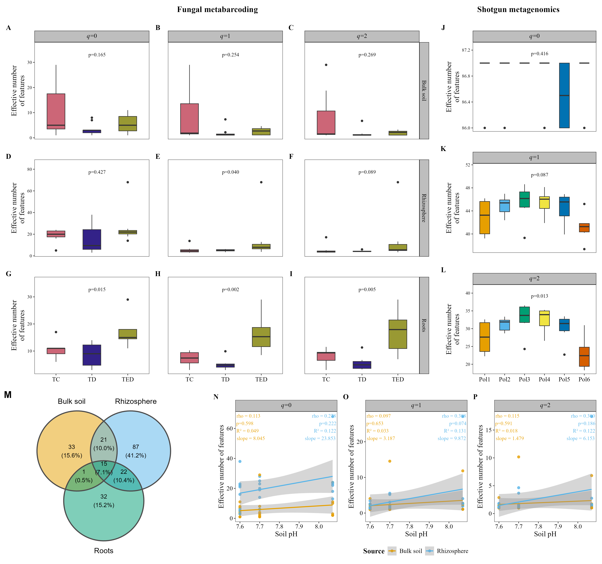
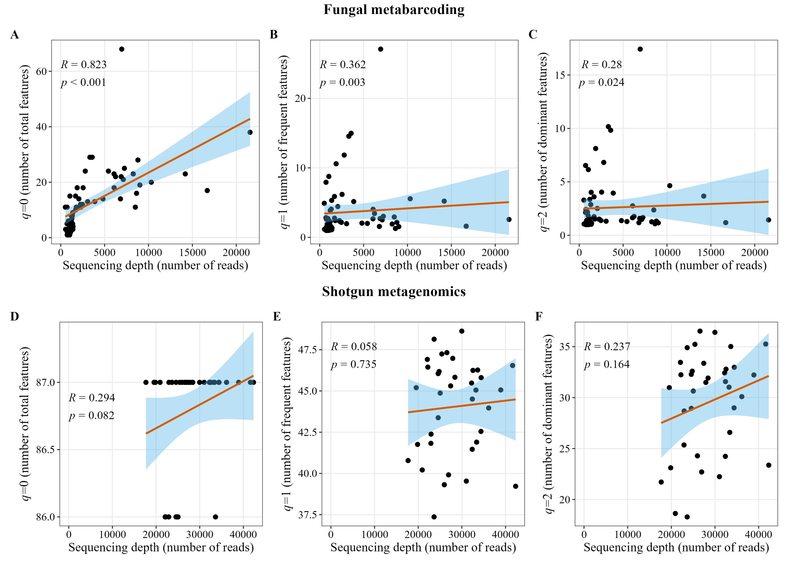

# Alpha diversity

Hill numbers, Venn diagram, alpha diversity vs pH and sequencing depth. The code is **not run on this page**: it is the code of [`2.alpha.R`](2.alpha.R) and the figures are the saved outputs.

## Main figure



## Supplementary figure: sequencing depth



## Code

<details>
<summary>Hill numbers vs sequencing depth</summary>

```r
source("1.load_data.R")

acm1 <- alpha_hill_corr_plot(table = table_fung )
acm2 <- alpha_hill_corr_plot(table = table_meta, facet_orientation ="vertical", title = NULL)

acms <- cowplot::plot_grid(acm1, acm2,labels = "AUTO", rel_widths = c(1.2,1), ncol = 1)
```

</details>

<details>
<summary>Hill numbers</summary>

```r
a1 <- alpha_hill_plot(table = table_fung,
                metadata = metadata_fungi,
                x_col = "Treatment",
                fill_col = "Treatment",
                group_colors = c(TC = "#CC6677", TD = "#332288", TED = "#999933"),
                facet_by = "Source",
                facet_orientation = "horizontal",
                panel_labels = c("D", "E", "F", "G", "H", "I", "J", "K", "L"),
                free_y = TRUE,
                stat = "kruskal.test",
                show_legend = FALSE,
                save_table = FALSE)

a2 <- alpha_hill_plot(table = table_meta,
                metadata = metadata_meta,
                x_col = "Polygon",
                fill_col = "Polygon",
                facet_orientation = "vertical",
                panel_labels = c("D", "E", "F"),
                free_y = TRUE,
                legend_title = "",
                stat = "kruskal.test",
               show_legend = FALSE,
                save_table = FALSE)

alphas1 <- cowplot::plot_grid(acm1, a1, rel_heights = c(1,2), ncol = 1)

alphas2 <- cowplot::plot_grid(acm2, a2,nrow = 1, rel_widths = c(1.2,1))
```

</details>

<details>
<summary>Alpha vs pH and Venn diagram</summary>

```r
metadata_fungi_decay <- metadata_fungi %>%
  filter(Source %in% c("Bulk soil", "Rhizosphere"))

ad <- alpha_decay_plot(table = table_fung,
                 metadata = metadata_fungi_decay,
                 cont_var = "pH",
                 group_col = "Source",
                 x_axis_title = "Soil pH")

venn <- venn_plot(table = table_fung,
          metadata = metadata_fungi,
          merge_by = "Source",
          min_prevalence = 0 )

alpha_more<- cowplot::plot_grid(ad, venn, labels = c("", "D"), label_size = 15, label_y = 1, rel_widths = c(1.7,1))
```

</details>

<details>
<summary>Main figure</summary>

```r
# ---- Main alpha figure: A-I fungi Hill, J-L metagenomic Hill, M Venn, N-P alpha vs pH
a1_fig <- alpha_hill_plot(table = table_fung,
                          metadata = metadata_fungi,
                          x_col = "Treatment",
                          fill_col = "Treatment",
                          group_colors = c(TC = "#CC6677", TD = "#332288", TED = "#999933"),
                          facet_by = "Source",
                          facet_orientation = "horizontal",
                          panel_labels = LETTERS[1:9],
                          free_y = TRUE,
                          stat = "kruskal.test",
                          show_legend = FALSE)

a2_fig <- alpha_hill_plot(table = table_meta,
                          metadata = metadata_meta,
                          x_col = "Polygon",
                          fill_col = "Polygon",
                          facet_orientation = "vertical",
                          panel_labels = LETTERS[10:12],
                          free_y = TRUE,
                          legend_title = "",
                          stat = "kruskal.test",
                          show_legend = FALSE)

ad_fig <- alpha_decay_plot(table = table_fung,
                           metadata = metadata_fungi_decay,
                           cont_var = "pH",
                           group_col = "Source",
                           x_axis_title = "Soil pH",
                           panel_labels = c("N", "O", "P"))

block_title <- function(txt) {
  cowplot::ggdraw() +
    cowplot::draw_label(txt, fontfamily = "serif", fontface = "bold", size = 16)
}

top_alpha <- cowplot::plot_grid(
  cowplot::plot_grid(block_title("Fungal metabarcoding"), a1_fig, ncol = 1,
                     rel_heights = c(0.05, 1)),
  cowplot::plot_grid(block_title("Shotgun metagenomics"), a2_fig, ncol = 1,
                     rel_heights = c(0.05, 1)),
  rel_widths = c(2.6, 1))
bottom_alpha <- cowplot::plot_grid(venn, ad_fig, labels = c("M", ""), label_size = 18,
                                   rel_widths = c(1, 1.9))
alpha_fig <- cowplot::plot_grid(top_alpha, bottom_alpha, ncol = 1,
                                rel_heights = c(1.65, 0.75))

ggsave("plots/alpha_fig.png", alpha_fig, width = 16, height = 15,
       units = "in", dpi = 300, bg = "white")
```

</details>

<details>
<summary>Supplementary figure</summary>

```r
acm1_supp <- alpha_hill_corr_plot(table = table_fung, title = NULL)
acm2_supp <- alpha_hill_corr_plot(table = table_meta, title = NULL,
                                  panel_labels = c("D", "E", "F"))
alpha_depth_supp <- cowplot::plot_grid(
  block_title("Fungal metabarcoding"), acm1_supp,
  block_title("Shotgun metagenomics"), acm2_supp,
  ncol = 1, rel_heights = c(0.07, 1, 0.07, 1))

ggsave("plots/alpha_depth_supp.png", alpha_depth_supp, width = 12, height = 8.6,
       units = "in", dpi = 300, bg = "white")
```

</details>
