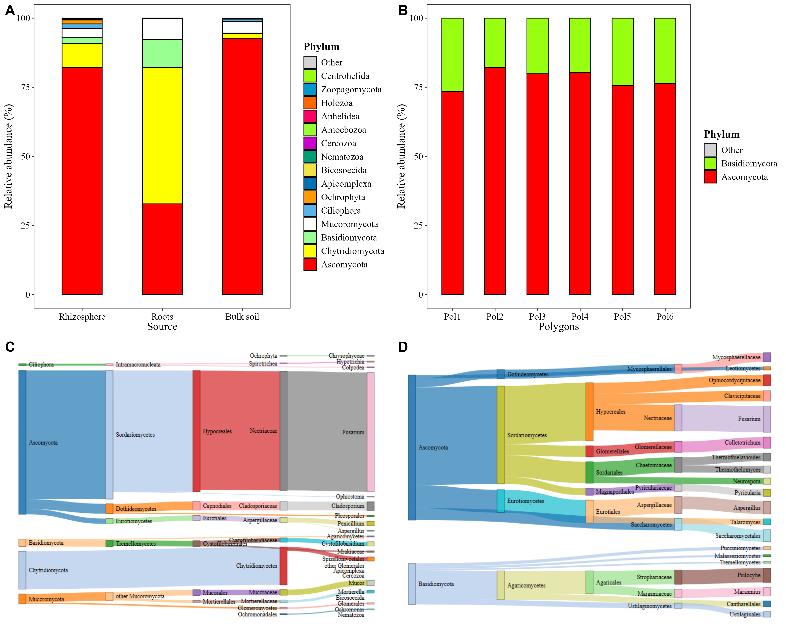
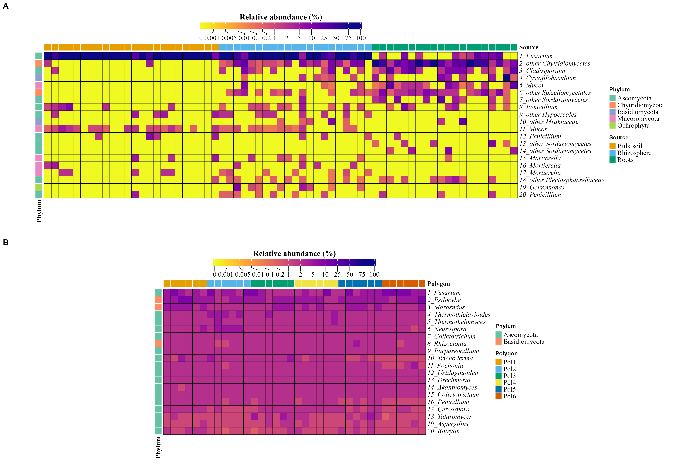

# Taxonomic composition

Bar plots, heatmaps and Sankey diagrams. The code is **not run on this page**: it is the code of [`4.abundance.R`](4.abundance.R) and the figures are the saved outputs.

## Main figure



## Heatmaps



## Code

<details>
<summary>Bar plots</summary>

```r
source("1.load_data.R")

barplot_metabarcoding <- abundance_bar_plot(
  table = table_fung,
  metadata = metadata_fungi,
  taxonomy_db = "silva",
  level = "phylum",
  x_col = "Source",
  label = "Phylum",
  x_axis_title = "Source",
  add_remained = TRUE
)

barplot_metagenomic <- abundance_bar_plot(
  table = table_meta,
  metadata = metadata_meta,
  taxonomy_db = "Kraken2",
  level = "phylum",
  x_col = "Polygon",
  x_axis_title = "Polygons",
  label = "Phylum",
  add_remained = TRUE)

both <- cowplot::plot_grid(barplot_metabarcoding, barplot_metagenomic, labels = "AUTO")
```

</details>

<details>
<summary>Heatmaps</summary>

```r
metadata_fungi1 <- metadata_fungi[
  order(metadata_fungi$Type_of_soil),
]

sample_order <- metadata_fungi1$SAMPLEID

table_fung1 <- table_fung[, c(
  sample_order[sample_order %in% colnames(table_fung)],
  "taxonomy"
)]

heat_metabarcoding <- abundance_heatmap_plot(
  table = table_fung1,
  metadata = metadata_fungi,
  condition1 = "Source",
  cluster = FALSE,
  show_column_names = FALSE,

  top_n = 20,
  cell_size = 4.5)

metadata_meta1 <- metadata_meta[
  order(metadata_meta$Polygon),
]

sample_order <- metadata_meta1$SAMPLEID

table_meta1 <- table_meta[, c(
  sample_order[sample_order %in% colnames(table_meta)],
  "taxonomy"
)]
heat_metagenomic <- abundance_heatmap_plot(
  table = table_meta1,
  metadata = metadata_meta1,
  condition1 = "Polygon",
  cluster = FALSE,
  show_column_names = FALSE,
  top_n = 20,
  cell_size = 4.5
)

both2 <- cowplot::plot_grid(heat_metabarcoding, heat_metagenomic, labels = "AUTO", ncol = 1)

ggsave("plots/heats.png", width = 17, height = 11.5, units = "in", dpi = 300, bg = "white")
```

</details>

<details>
<summary>Sankey diagrams</summary>

```r
sankey_metabarcoding <- abundance_sankey_plot(
  table = table_fung,
  taxonomy_db = "silva",
  maxn = 10,
  taxRanks    = c("P", "C", "O", "F", "G"),
  output_file = "plots/sankey1.html"

  )

sankey_metagenomic <- abundance_sankey_plot(
  table = table_meta,
  taxonomy_db = "Kraken2",
  maxn = 10,
  taxRanks    = c("P", "C", "O", "F", "G"),
  output_file = "plots/sankey2.html"
)

sankey_metabarcoding
sankey_metagenomic

library(htmlwidgets)
library(webshot2)

webshot("plots/sankey1.html", vwidth = 800, vheight = 600, file = "plots/sankey1.png")
img1 <- png::readPNG("plots/sankey1.png")
g1 <- grid::rasterGrob(img1)

webshot("plots/sankey2.html", vwidth = 800, vheight = 600, file = "plots/sankey2.png")
img2 <- png::readPNG("plots/sankey2.png")
g2 <- grid::rasterGrob(img2)

both3 <- cowplot::plot_grid(g1,g2, labels = c("A", "B"), label_size = 15, label_y = 1)
```

</details>

<details>
<summary>Main figure</summary>

```r
abundance_fig <- cowplot::plot_grid(
  cowplot::plot_grid(barplot_metabarcoding, barplot_metagenomic,
                     labels = c("A", "B"), label_size = 18),
  cowplot::plot_grid(g1, g2, labels = c("C", "D"), label_size = 18),
  ncol = 1, rel_heights = c(6, 5.3))
ggsave("plots/abundance_fig.png", abundance_fig, width = 14, height = 11.3,
       units = "in", dpi = 300, bg = "white")
```

</details>
