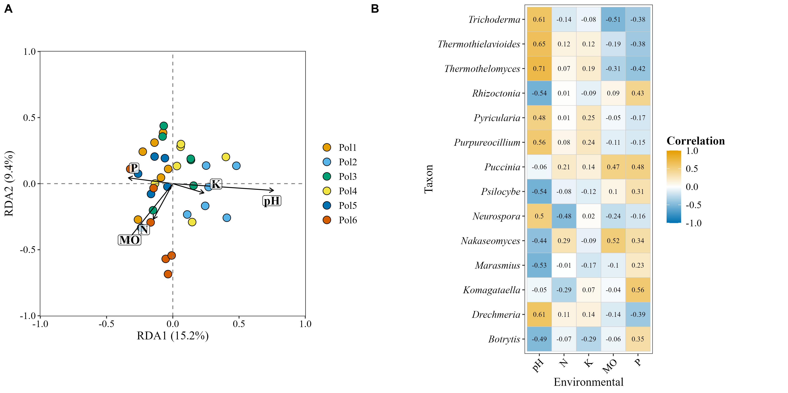

# Taxa–environment links

Spearman correlations and RDA. The code is **not run on this page**: it is the code of [`6.environmental.R`](6.environmental.R) and the figures are the saved outputs.

## Main figure



## Code

<details>
<summary>Environmental data</summary>

```r
source("1.load_data.R")

env_vars_meta <- c("pH", "MO", "N", "P", "K")

env_meta <- metadata_meta %>%
  dplyr::select(SAMPLEID, all_of(env_vars_meta)) %>%
  tibble::column_to_rownames("SAMPLEID")
```

</details>

<details>
<summary>Spearman correlations</summary>

```r
corr_genus <- corr_env_abund_plot(table = table_meta,
                                  env_data = env_meta,
                                  metadata = metadata_meta,
                                  taxonomy_db = "Kraken2",
                                  level = "genus",
                                  method = "spearman",
                                  p_adjust_method = "BH",
                                  pval_threshold = 0.05)
```

</details>

<details>
<summary>RDA</summary>

```r
set.seed(123)
rda_meta <- cca_rda_biplot(table = table_meta,
                           env_data = env_meta,
                           metadata = metadata_meta,
                           env_vars = env_vars_meta,
                           analysis = "RDA",
                           show_all_env_vectors = TRUE,
                           group_col = "Polygon",
                           scale_arrows = 1,
                           title = NULL)
```

</details>

<details>
<summary>Main figure</summary>

```r
env_fig <- cowplot::plot_grid(rda_meta, corr_genus, labels = "AUTO",
                              nrow = 1, rel_widths = c(1, 1.15))

ggsave("plots/environmental.png", env_fig,
       width = 13, height = 6.5, units = "in", dpi = 300, bg = "white")
```

</details>
