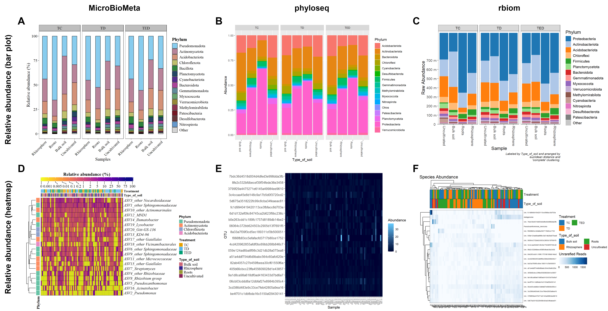
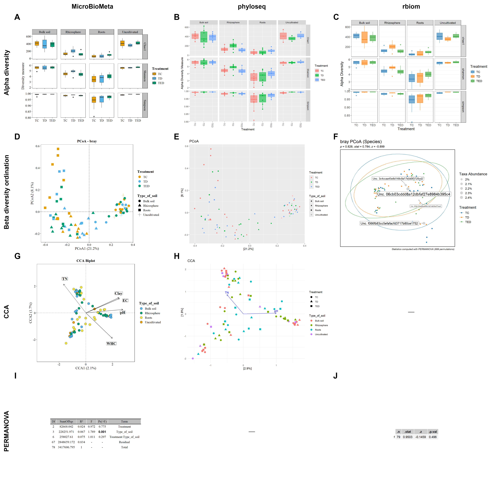

# Comparison with phyloseq and rbiom

Same data, same analyses, three packages. The code below is **not run on this
page**: it is the code of [`7.comparation.R`](7.comparation.R), and the figures
are the saved outputs. Figures S1 and S2 of the article are in
`figuras_comparacion/`.

**Data:** bacterial example dataset of MicroBioMeta, Month 2 (79 samples, 3,645
ASVs), grouped by Treatment and Type of soil.

**Versions:** phyloseq 1.56, rbiom 3.1.0.

<details>
<summary>Setup: loading the data and building the phyloseq and rbiom objects</summary>

```r
library(MicroBioMeta)
library(phyloseq)
library(rbiom)
library(tidyverse)

bacteria_table <- read.delim(
  system.file("extdata", "table_bacteria.txt", package = "MicroBioMeta"),
  row.names = 1, check.names = FALSE
)

taxonomy_bacteria <- read.delim(
  system.file("extdata", "taxonomy_bacteria.txt", package = "MicroBioMeta"),
  check.names = FALSE
) %>%
  rename(taxonomy = Taxon) %>%
  dplyr::select(-Confidence) %>%
  column_to_rownames(var = "Feature.ID")

bacteria_metadata <- read.delim(
  system.file("extdata", "metadata_bacteria.txt", package = "MicroBioMeta"),
  check.names = FALSE
) %>%
  filter(Month == "2")

samples_bac <- bacteria_metadata$SAMPLEID[
  bacteria_metadata$SAMPLEID %in% colnames(bacteria_table)]

table_bacteria <- bacteria_table[, samples_bac]

metadata_bacteria <- bacteria_metadata[
  bacteria_metadata$SAMPLEID %in% samples_bac, ]
metadata_bacteria$Treatment <- as.factor(metadata_bacteria$Treatment)

# data MBM
table_bac <- merge_feature_taxonomy(table = table_bacteria,
                                    taxonomy = taxonomy_bacteria)


env_table_bac <- metadata_bacteria %>%
  dplyr::select(SAMPLEID, pH:Arbus_per) %>%
  remove_rownames() %>%
  column_to_rownames(var = "SAMPLEID")

#phyloseq object

otu_bac  <- otu_table(as.matrix(table_bacteria), taxa_are_rows = TRUE)
tax_bac  <- tax_table(as.matrix(taxonomy_bacteria))
meta_bac <- sample_data(data.frame(metadata_bacteria,
                                   row.names = metadata_bacteria$SAMPLEID))

ps_bacteria <- phyloseq(otu_bac, tax_bac, meta_bac)

tax_df <- as.data.frame(as(tax_table(ps_bacteria), "matrix"))
nombre_columna <- colnames(tax_df)[1]

tax_limpia <- tax_df %>%
  separate(!!sym(nombre_columna),
           into = c("Domain", "Phylum", "Class", "Order", "Family", "Genus", "Species"),
           sep = ";\\s*", fill = "right") %>%
  mutate(across(everything(), ~ gsub("^[a-z]__", "", .)))
tax_limpia[tax_limpia == ""] <- NA
rownames(tax_limpia) <- rownames(tax_df)
tax_table(ps_bacteria) <- tax_table(as.matrix(tax_limpia))

# rbiom
data <- as_rbiom(ps_bacteria)
```

</details>

## Taxonomic composition (Figure S1)



### Bar plot

<details>
<summary>MicroBioMeta</summary>

```r
p <- abundance_bar_plot(table = table_bac,
                        metadata = metadata_bacteria,
                        taxonomy_db = "silva",
                        level = "phylum",
                        top_n = 15,
                        x_col = "Type_of_soil",
                        facet_by = "Treatment",
                        add_remained = TRUE,
                        label = "Phylum",
                        x_label_angle = 45,
                        palette = "safe",
                        taxa_order = "descending",
                        save_table = FALSE)
p
```

</details>

<details>
<summary>phyloseq</summary>

```r
ps_clas <- phyloseq::subset_taxa(ps_bacteria, !is.na(Phylum))
ps_filo <- phyloseq::tax_glom(ps_clas, taxrank = "Phylum", NArm = FALSE)
ps_rel <- phyloseq::transform_sample_counts(
ps_filo, function(x) { total <- sum(x, na.rm = TRUE); if (total > 0) x / total else x })
meta <- data.frame(sample_data(ps_rel), check.names = FALSE)
meta$Group <- paste(meta$Type_of_soil, meta$Treatment, sep = "_")
sample_data(ps_rel)$Group <- meta$Group
ps_prom <- phyloseq::merge_samples(ps_rel, group = "Group", fun = mean)
df_meta <- data.frame(Group = sample_names(ps_prom))
df_meta <- tidyr::separate(df_meta, col = Group,
                           into = c("Type_of_soil", "Treatment"),
                           sep = "_", remove = FALSE)
rownames(df_meta) <- df_meta$Group
sample_data(ps_prom) <- phyloseq::sample_data(df_meta)
ps_prom <- phyloseq::transform_sample_counts(ps_prom, function(x) x / sum(x))

tax_mat   <- as(phyloseq::tax_table(ps_prom), "matrix")
asignados <- rownames(tax_mat)[!is.na(tax_mat[, "Phylum"])]
top15 <- names(sort(phyloseq::taxa_sums(ps_prom)[asignados], decreasing = TRUE))[1:15]
otros <- !(rownames(tax_mat) %in% top15)
tax_mat[otros, c("Domain", "Phylum")] <- "Otros"
phyloseq::tax_table(ps_prom) <- phyloseq::tax_table(tax_mat)

ps_final <- phyloseq::tax_glom(ps_prom, taxrank = "Phylum", NArm = FALSE)
p <- phyloseq::plot_bar(ps_final, x = "Type_of_soil", fill = "Phylum",
                        facet_grid = ~Treatment) +
  ggplot2::geom_bar(ggplot2::aes(color = Phylum, fill = Phylum),
                    stat = "identity", position = "stack")
p
```

</details>

<details>
<summary>rbiom</summary>

```r
ps_clas <- phyloseq::subset_taxa(ps_bacteria, !is.na(Phylum))

ps_rel <- phyloseq::transform_sample_counts(
  ps_clas, function(x) { total <- sum(x, na.rm = TRUE); if (total > 0) x / total else x })

meta <- data.frame(sample_data(ps_rel), check.names = FALSE)
meta$Group <- paste(meta$Type_of_soil, meta$Treatment, sep = "_")
sample_data(ps_rel)$Group <- meta$Group

ps_prom <- phyloseq::merge_samples(ps_rel, group = "Group", fun = mean)

df_meta <- data.frame(Group = sample_names(ps_prom))
df_meta <- tidyr::separate(df_meta, col = Group,
                           into = c("Type_of_soil", "Treatment"),
                           sep = "_", remove = FALSE)
rownames(df_meta) <- df_meta$Group
sample_data(ps_prom) <- phyloseq::sample_data(df_meta)

d  <- as_rbiom(ps_prom)
d3 <- biom_relativize(d)
p  <- taxa_stacked(d3, rank = "Phylum", taxa = 15,
                   label.by = "Type_of_soil", facet.by = "Treatment")
p
```

</details>

### Heatmap

<details>
<summary>MicroBioMeta</summary>

```r
suppressWarnings(
  print(abundance_heatmap_plot(table = table_bac,
                               metadata = metadata_bacteria,
                               top_n = 20,
                               exclude_unclassified = FALSE,
                               cluster = TRUE,
                               show_column_names = FALSE,
                               condition1 = "Treatment",
                               condition2 = "Type_of_soil",
                               feature_prefix = "ASV",
                               draw = FALSE))
)
```

</details>

<details>
<summary>phyloseq</summary>

```r
ps_nz  <- phyloseq::prune_taxa(phyloseq::taxa_sums(ps_bacteria) > 0, ps_bacteria)
ps_rel <- phyloseq::transform_sample_counts(ps_nz, function(x) x / sum(x) * 100)

top_asv <- names(sort(phyloseq::taxa_sums(ps_rel), decreasing = TRUE))[
  seq_len(min(20, phyloseq::ntaxa(ps_rel)))]
ps_top <- phyloseq::prune_taxa(top_asv, ps_rel)

p <- phyloseq::plot_heatmap(ps_top,
                            method       = "NMDS",
                            sample.order = phyloseq::sample_names(ps_top),
                            taxa.order   = NULL,
                            trans        = scales::identity_trans())
print(p)
```

</details>

<details>
<summary>rbiom</summary>

```r
p <- rbiom::taxa_heatmap(data,
                         rank   = 7,
                         taxa   = 20,
                         tracks = c("Treatment", "Type_of_soil"),
                         grid   = blues9)
print(p)
```

</details>

## Diversity and ordination (Figure S2)

Bray-Curtis is used in the ordination only because the three packages offer it,
so the results can be compared. A dash in the figure means the package has no
equivalent function.



### Alpha diversity

<details>
<summary>MicroBioMeta</summary>

```r
p <- alpha_diversity_plot(table = table_bac,
                          metadata = metadata_bacteria,
                          x_col = "Treatment",
                          fill_col = "Treatment",
                          facet_by = "Type_of_soil",
                          facet_orientation = "vertical",
                          save_table = FALSE,
                          palette = "colorb",
                          legend_title = "Treatment",
                          legend_position = "right",
                          aspect_ratio = 1,
                          free_y = FALSE,
                          panel_labels = rep("", 12))
p
```

</details>

<details>
<summary>phyloseq</summary>

```r
p <- phyloseq::plot_richness(ps_bacteria,
                             x = "Treatment",
                             color = "Treatment",
                             measures = c("Chao1", "Shannon", "Simpson")) +
  ggplot2::geom_boxplot(ggplot2::aes(fill = Treatment), alpha = 0.6) +
  ggplot2::facet_grid(variable ~ Type_of_soil, scales = "free_y")
p
```

</details>

<details>
<summary>rbiom</summary>

```r
p <- rbiom::adiv_boxplot(data,
                         x = "Treatment",
                         facet.by = "Type_of_soil",
                         adiv = c("chao1", "shannon", "simpson"))
p
```

</details>

### Beta diversity ordination

<details>
<summary>MicroBioMeta</summary>

```r
p <- beta_ord_plot(table = table_bac,
                   metadata = metadata_bacteria,
                   distance = "bray",
                   ordination = "PCoA",
                   group_col = "Treatment",
                   shape_col = "Type_of_soil",
                   palette = "colorb")
p
```

</details>

<details>
<summary>phyloseq</summary>

```r
ord <- phyloseq::ordinate(ps_bacteria, method = "PCoA", distance = "bray")
p <- phyloseq::plot_ordination(ps_bacteria, ord,
                               type  = "samples",
                               color = "Treatment",
                               shape = "Type_of_soil",
                               title = "PCoA")
p
```

</details>

<details>
<summary>rbiom</summary>

```r
p <- rbiom::bdiv_ord_plot(data,
                          bdiv = "bray",
                          ord = "PCoA",
                          layers = "petm",
                          stat.by = "Treatment",
                          facet.by = NULL,
                          colors = TRUE,
                          shapes = TRUE,
                          tree = NULL,
                          test = "adonis2",
                          seed = 0,
                          permutations = 999)
p
```

</details>

### CCA

<details>
<summary>MicroBioMeta</summary>

```r
p <- cca_rda_biplot(table = table_bac,
                    env_data = env_table_bac,
                    metadata = metadata_bacteria,
                    env_vars = c("pH", "TN", "WHC", "EC", "Clay"),
                    analysis = "CCA",
                    show_all_env_vectors = TRUE,
                    group_col = "Type_of_soil",
                    legend_title = "Type_of_soil",
                    scale_arrows = 3)
p
```

</details>

<details>
<summary>phyloseq</summary>

```r
cca_resultado <- phyloseq::ordinate(ps_bacteria, method = "CCA",
                                    formula = ~ pH + TN + WHC + EC + Clay)

p <- phyloseq::plot_ordination(ps_bacteria, cca_resultado, type = "samples",
                               color = "Type_of_soil", shape = "Treatment") +
  ggplot2::theme_minimal() +
  ggplot2::geom_point(size = 3) +
  ggplot2::labs(title = "CCA")
flechas <- as.data.frame(cca_resultado$CCA$biplot)
flechas$Variable <- rownames(flechas)

p <- p +
  ggplot2::geom_segment(data = flechas,
                        ggplot2::aes(x = 0, y = 0, xend = CCA1, yend = CCA2),
                        arrow = grid::arrow(length = grid::unit(0.2, "cm")),
                        color = "blue", inherit.aes = FALSE) +
  ggplot2::geom_text(data = flechas,
                     ggplot2::aes(x = CCA1, y = CCA2, label = Variable),
                     color = "blue", vjust = -0.5, inherit.aes = FALSE)
p
```

</details>

### PERMANOVA

<details>
<summary>MicroBioMeta: compositional distance, Treatment × Type of soil</summary>

```r
set.seed(123)
p <- beta_test_table(table = table_bac,
                     metadata = metadata_bacteria,
                     formula_str = "Treatment*Type_of_soil",
                     distance = "compositional",
                     test = "permanova",
                     permutations = 999)
p
```

</details>

<details>
<summary>rbiom: euclidean distance, one factor (Treatment)</summary>

```r
set.seed(123)
dm     <- rbiom::bdiv_distmat(data, bdiv = "euclidean")
grupos <- pull(data, "Treatment")
p <- rbiom::distmat_stats(dm, groups = grupos, test = "adonis2")
p
```

</details>
